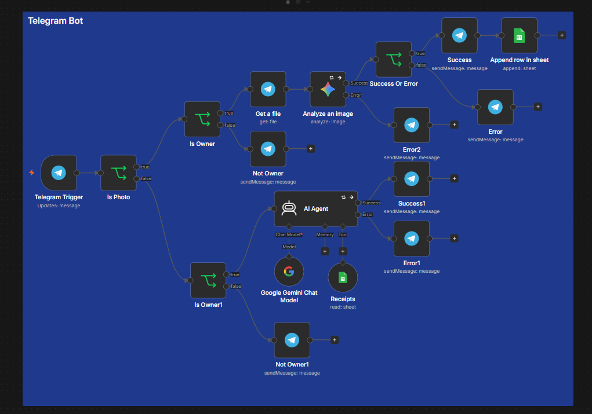
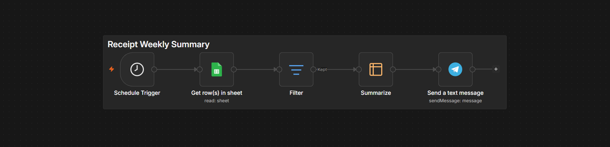

# Telegram Receipt Bot

A private Telegram bot that turns photos of receipts into a structured expense log, sends a weekly spending summary, and answers questions about past payments in plain language.

Built with n8n (self-hosted), Google Gemini, Google Sheets and the Telegram Bot API. It is a side project, built to stay sharp and to document the decisions behind it.

## What it does

- **Logs receipts.** Send a photo. The bot reads the merchant, date, total, currency and category, writes one row to a Google Sheet, and confirms what it logged.
- **Refuses to guess.** If the photo is blurry or is not a receipt, it asks for a clearer photo and writes nothing.
- **Weekly summary.** Every Sunday at 18:00 it totals the last 7 days by category and currency and sends one message.
- **Answers questions.** Ask "what did I spend on 19 Oct?" and an AI agent reads the sheet and replies with the matching receipts and a total.
- **Stays private.** Only the owner's Telegram chat ID is served. Everyone else gets a fixed refusal, on both the photo and the text paths.

## Workflows

**Telegram Bot.** Receipts, chat questions, the owner lock and the error paths, in one workflow.



**Receipt Weekly Summary.** Reads the sheet on a schedule and sends one message.



<!--
Add these after saving the files to docs/images/ (blur any personal data first):

| Receipt confirmation | Chat answer |
| --- | --- |
|  |  |
-->

## How it works

```
Telegram message
      |
  Is Photo? --- yes --> Is Owner? --- yes --> Get file --> Gemini (reads receipt, returns JSON)
      |                      |                                      |
      |                      no --> refusal                  Valid total and date?
      |                                                      |                  |
      no                                                    yes                 no
      |                                                      |                  |
  Is Owner? --- yes --> AI Agent (Gemini + Sheets tool)   confirm +        ask for a
      |                      |                            append row       clearer photo
      no --> refusal    answer, or friendly error
```

Second workflow, on a schedule:

```
Schedule (Sunday 18:00) --> read sheet --> keep last 7 days --> sum by category + currency --> one Telegram message
```

## Stack

| Piece | Used for |
| --- | --- |
| n8n (2.x, Docker, self-hosted) | Orchestration |
| Google Gemini 2.5 Flash-Lite | Reading receipt photos, answering questions |
| Google Sheets | The expense log |
| Telegram Bot API | Interface |
| ngrok (static domain) | Public HTTPS URL for the Telegram webhook |

## Setup

You need Docker, a Telegram account, a Google account, a Gemini API key and an ngrok account with a static domain.

1. **Create the bot.** Talk to @BotFather, run `/newbot`, and keep the token. Do not paste it anywhere except n8n's credential manager.
2. **Create the sheet.** Import `docs/sheet-template.csv` into a new Google Sheet (File, Import) so row 1 holds the six headers: `date, merchant, total, currency, category, message_id`. The headers must match exactly.
3. **Start n8n.** Copy `docker/docker-compose.example.yml` to `docker-compose.yml`, put your ngrok domain in `WEBHOOK_URL` and `N8N_EDITOR_BASE_URL` (keep the trailing slash), then:
   ```
   docker compose up -d
   ngrok http --url=YOUR-DOMAIN.ngrok-free.dev 5555
   ```
4. **Add credentials in n8n:** Telegram API (the BotFather token), Google Gemini (PaLM) API, and Google Sheets OAuth2.
5. **Import both workflows** from `workflows/`. They are exported without credential IDs, so reconnect the credential on every node that shows a warning.
6. **Replace the placeholders:**
   - `YOUR_CHAT_ID` in the two **Is Owner** nodes: type your numeric chat ID in the right-hand value. Leaving text there fails with a "wrong type" error.
   - `YOUR_CHAT_ID` in **Send a text message** in the weekly workflow.
   - Re-select the **Receipts** document and sheet from the list in the three Google Sheets nodes.
   - To find your chat ID, open the Telegram Trigger's test output after messaging the bot and read `message.chat.id`.
7. **Publish both workflows.** Test mode and production mode use different webhook URLs, and Telegram allows one webhook per bot. Publishing registers the production one.

## Design decisions

- **Validate before writing.** Gemini returns one JSON object that holds both the extracted data and the reply text. An IF node checks that `total` is a positive number and `date` parses as ISO before anything reaches the sheet. This caught a real failure: at one point the model returned only the reply lines without the JSON, and the check routed it to the retry message instead of writing a broken row.
- **Null over guess.** The prompt tells the model to return `null` for anything it cannot read. A confident wrong total is worse than asking for a clearer photo.
- **Totals group by category and currency.** Adding 450 MAD and 20 EUR of groceries gives a meaningless number, so each currency gets its own line.
- **Owner lock on both paths.** The check compares the sender's `chat.id`, which Telegram sets and the sender cannot change. The refusal says the attempt is recorded, which is true: every incoming message appears in n8n's Executions.
- **Failures get a reply.** The Gemini nodes use the error output with retries, so a rate limit (HTTP 429) or a network error produces a short message instead of silence.
- **Escaped HTML.** Replies use HTML parse mode, and model text is escaped first. A merchant like `H&M` would otherwise be rejected by Telegram.
- **Execute Once on the weekly send.** The summary is built from all items at once. Without Execute Once, a week with several categories would send one identical message per category.
- **Dates read as DD/MM/YYYY.** The prompt assumes day-first dates, which matches Moroccan and French receipts. Change it in the prompt if yours differ.

## Known limitations

- **Needs a machine that is on.** It runs on a local Docker host. If the machine is off, receipts are not read and the Sunday summary does not fire.
- **Gemini free-tier quota.** Heavy use returns rate-limit errors. The bot says so, but it cannot work around the quota.
- **No duplicate detection.** Sending the same receipt twice logs it twice.
- **The chat agent does the arithmetic.** Totals in chat answers are added by the model. Each receipt is listed so a total can be checked by eye. The weekly summary uses n8n's own Summarize node, so its sums are exact.
- **No chat memory.** Each question is answered on its own, so follow-ups like "and the day before?" do not work.
- **Categories are enforced by the prompt only.** Nothing rejects a category outside the list.
- **Empty weeks send nothing.** With no receipts in the last 7 days the summary is skipped, not sent as "0".

## Ideas for later

- Duplicate detection on merchant, date and total
- Receipts sent as files (PDF or image documents)
- A `correct: total 290` reply that fixes the last row
- Simple Memory for the chat agent

## Repository layout

```
workflows/
  telegram-bot.json        receipts, chat, owner lock
  weekly-summary.json      Sunday summary
docker/
  docker-compose.example.yml
docs/
  sheet-template.csv       header row for the Google Sheet
  images/                  workflow screenshots
scripts/
  check-secrets.ps1        scan before pushing
```

## License

MIT. See `LICENSE`.
